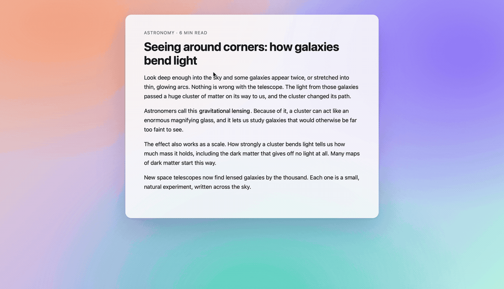

<div align="center">

# Quick Chat

**ChatGPT on ⌥Space. A small chat panel that looks and feels like part of your Mac.**

Press ⌥Space in any app, ask a question, read the answer, and go back to your work.
Every message is a regular ChatGPT chat, not an agent task.

This is a fork of [shuaibird/Quick-Chat](https://github.com/shuaibird/Quick-Chat), with many additional UI changes.




*Press ⌥Space, ask, get an interactive diagram, explore it in a large window, and go back to reading.*

</div>

## Highlights

- **Always one key away.** ⌥Space opens the panel over any app, also over full-screen apps. Esc closes it.
- **It does not take the focus from your app.** Like Spotlight, the panel takes your typing, but the app you were in stays active.
- **It looks native.** The panel has the macOS translucent material, rounded corners with a real shadow, and the system font with the system's font smoothing. It follows ChatGPT's light or dark theme; the light theme gets a lighter, white-tinted material so that ChatGPT's gray text stays readable.
- **Only the chat.** The empty chat shows only the composer. Greetings, suggestions, notices, the disclaimer and the selection toolbars are hidden.
- **The title bar comes when you need it.** In the small panel, it shows while the pointer is over the panel, and fades out 0.5 seconds after the pointer leaves. Then the messages use its space. In the large window, it always shows.
- **Small or large.** **Expand** (or a double-click on the title bar, or ⌃⌘F) makes the panel a large window with the same chat. **Shrink** makes it small again. A panel that you make 768 points wide or more also counts as large: ChatGPT then docks its sidebar, and the button shows **Shrink**, which goes back to the default size. The page never shows a half-drawn layout during the change.
- **Move it from anywhere.** Like ChatGPT's own companion window, you can drag the panel by the title bar or by any empty space: between and beside messages, or in the composer around its text field. Text, messages, answers and controls keep working as usual.
- **Throw it to the side.** Drag the panel fast and let go while you move, and the panel flies to the left or right edge of the screen, like ChatGPT's own companion window. A slow drag, or a drag that stops before you let go, moves the panel only as far as the pointer.
- **Temporary chats.** One click starts a chat that does not go into your history. The icon fills while a temporary chat is on.
- **Ready when you are.** ChatGPT loads in the background when the app starts. While a page loads, the panel shows a spinner instead of a half-loaded page.
- **Interactive answers.** The panel is ChatGPT on the web, so it shows ChatGPT's interactive answers: diagrams, simulations, sliders and buttons inside the chat. ChatGPT Classic shows only text and standard formatting.
- **Always up to date.** You get every new ChatGPT web feature on the day it ships, with your own account and your own models.

## Why this exists

ChatGPT Classic for Mac has a chat bar on ⌥Space: you press it in any app, ask a question, and get a normal chat.

The new ChatGPT desktop app (Chat, Work and Codex) works differently:

- **⌥Space opens Mini.** Mini starts Work and Codex agent tasks, not plain chats.
- **The experimental Popout Window** (Settings → Experimental features) also starts agent tasks.
- **Plain chat is only in the app window.** No system-wide shortcut opens it.

This is important because the two kinds of use have different limits. Work and Codex share one usage allowance, with a 5-hour window and a weekly limit. Chat has its own model availability and message limits ([OpenAI: Managing usage in Work and Codex](https://help.openai.com/en/articles/20001516)). A quick question through Mini uses the agent allowance that you may want to keep for real tasks.

ChatGPT Classic is also falling behind:

- **New features skip it.** OpenAI says that new features may come only to the new app ([OpenAI: Moving to the new ChatGPT desktop app](https://help.openai.com/en/articles/20001276)).
- **It cannot show Intelligent UI**, the GPT-6 answers that mix text, visuals and interactive elements. OpenAI tells you to use ChatGPT on the web for them ([OpenAI: GPT-6 and other models in ChatGPT](https://help.openai.com/en/articles/20001354-gpt-6-and-other-models-in-chatgpt)).

Quick Chat shows chatgpt.com in a small floating panel. So you keep the ⌥Space chat bar, and every message is a regular ChatGPT chat with all web features.

Quick Chat works next to the new ChatGPT desktop app, and it can free ⌥Space from the Mini shortcut. It does not need any ChatGPT app: without one, it works alone.

## Install

You can install Quick Chat in three ways. The first one is recommended.

**1. With an AI assistant (recommended):** tell Claude, ChatGPT or another coding assistant:
*"Read https://github.com/Issaminu/Quick-Chat/blob/main/INSTALL.md and install Quick Chat."*
[INSTALL.md](INSTALL.md) gives the assistant step-by-step instructions: it checks your Mac, builds the app, installs it, and helps with the first run. The app is built on your own Mac, from this source. macOS does not quarantine an app that you build yourself, so it opens without a warning, and you run only code that you can read.

**2. Download the app:** get `Quick-Chat-<version>.zip` from the [latest release](https://github.com/Issaminu/Quick-Chat/releases/latest). It runs on Apple silicon and Intel Macs with macOS 14 or later. The app is **not signed with an Apple Developer ID and not notarized** (it is signed ad-hoc). So macOS blocks it the first time you open it:

1. Unzip the file, and move `Quick Chat.app` to your Applications folder.
2. Open the app. macOS says that it cannot verify the app. Click **Done** (not **Move to Trash**).
3. Open **System Settings → Privacy & Security**. Below **Security**, find the message about Quick Chat, and click **Open Anyway**. Confirm with your password or Touch ID.
4. Open the app again, and click **Open**. After this first time, the app opens normally.

On macOS 14, you can also right-click the app, choose **Open**, then click **Open**. To check the download, run `shasum -a 256 -c Quick-Chat-<version>.zip.sha256` in the folder with both files. To update, download the new release and replace the app.

**3. By hand, from source:** you need macOS 14 or later and Swift 6.0 or later. Xcode 16 or later is recommended. The Command Line Tools alone (`xcode-select --install`) can build for one architecture. If `swift build` fails with "Unknown error parsing property list", install Xcode.

```sh
git clone https://github.com/Issaminu/Quick-Chat.git
cd Quick-Chat
make install    # build, then copy to /Applications (or: make install PREFIX=~/Applications)
open "/Applications/Quick Chat.app"
```

Other commands:

```sh
make            # build and sign "build/Quick Chat.app" only
make run        # build, quit a running copy, and open the new one
make uninstall  # remove the app from /Applications
make clean      # remove .build and build/
```

**Update:** `git pull && make install` in the clone.

Quick Chat shows in the menu bar. It has no Dock icon.

## Use it

1. Click the menu-bar icon, and make sure **Quick Chat** is on. It turns on by itself at launch.
2. Press **⌥Space**. The panel opens at the bottom center of the screen under the pointer.
3. Sign in to ChatGPT once, inside the panel. Email, Apple or Microsoft sign-in is the most reliable.
4. Ask. Press ⌥Space, Esc or ⌘W to close the panel. The next ⌥Space opens the same conversation again, with your draft.

Each time Quick Chat starts after a normal quit, it starts with empty drafts. After a crash, your drafts stay.

To start Quick Chat at login: **System Settings → General → Login Items → Open at Login → +**, then select Quick Chat.

### Keyboard shortcuts

| Shortcut | Action |
| --- | --- |
| ⌥Space | Open or close the panel (change it with **Change Shortcut…** in the menu) |
| Esc or ⌘W | Close the panel. While a menu, a dialog or the sidebar is open, Esc closes that first. |
| ⌘N | New chat, without a page reload |
| ⌘B | Show or hide the sidebar |
| ↑ ↓, Return or Space | In the sidebar: select a conversation, then open it. They work while the sidebar of a small panel is open, and after a click in a docked sidebar until you type or click in another place. |
| ⌘F | Find text on the page. Return or ⌘G shows the next match, ⇧Return or ⇧⌘G the previous match. Esc closes the find bar. |
| ⌃⌘F | Expand to a large window, or shrink back (change it with **Change Shortcut…** in the menu) |
| ⌘O | Reset the panel to its default size (440 × 540) |
| ⌘K | Search your chats (ChatGPT) |
| ⌘U | Attach files (ChatGPT) |
| ⌘/ | Show all of ChatGPT's shortcuts |

The ChatGPT shortcuts come from chatgpt.com. They all work in the panel.

### Find

Press ⌘F to find text on the page. The find bar shows below the title bar, and it marks all matches while you type. The current match is orange, and the page scrolls to it. The bar shows the number of matches, for example "2 of 7". The search ignores upper and lower case. It finds only text that shows on the page and that you can select: the messages and your draft. When ChatGPT writes an answer, the count changes with it. Esc or the bar's close button closes the bar and removes the marks. The clear button in the field also removes them. The next ⌘F shows the same text again.

### The title bar

In the small panel, the title bar shows while the pointer is over the panel, and all its buttons show at once and fade out together. In a large panel (expanded, or 768 points wide or more), it always shows.

| Place | Button | Action |
| --- | --- | --- |
| Top left | Sidebar | Opens ChatGPT's sidebar with your chats and projects (same as ⌘B). |
| Top left | Expand / Shrink | Makes the panel a large window with the same chat, or small again (same as ⌃⌘F). |
| Top right | Temporary Chat | Starts or ends a temporary chat (in an empty chat). |
| Top right | New Chat | Starts a new chat (in a conversation, same as ⌘N). |
| Top right | Close | Closes the panel (same as Esc). |

Drag the title bar or any empty space to move the panel. Throw it (a fast drag) to send it to a side of the screen. Drag an edge to resize it. Each time the app starts, the panel first opens at its default place. It keeps its size across launches.

In a large panel, ChatGPT docks its row of icons on the left. Point at them to see the sidebar, or press ⌘B to open or close the full sidebar.

## Design details

Quick Chat changes how chatgpt.com looks inside the panel. It changes only the look, not what the page does:

- **One material.** The page background is transparent, so the panel's native translucent material shows through. Menus, the sidebar and floating buttons keep their own backgrounds.
- **Concentric corners.** The window corners have a 20-point radius. The composer sits 8 points from the sides and the bottom, so its corners have a 12-point radius (20 − 8), with the same center.
- **A clear message area.** Messages stop at the top edge of the composer and fade out above it, so no text shows beside, below or through the composer. At the top, messages stop at the bottom edge of the title bar.
- **Native text.** Text uses the system font with the system's font smoothing, and message text is 15 points. As in a native app, only message text, the composer and form fields can be selected; buttons, labels, the title bar and the sidebar cannot, also with ⌘A. Focus rings show only while you move the focus with Tab.
- **Quiet scrolling.** The message list and a long draft in the composer have a thin rounded scroll bar inside the right edge. They do not stretch at the ends. A code block scrolls its code first, then the conversation.
- **The cursor stays in view.** In a long draft, the composer scrolls with the text cursor while you type, paste or move the cursor.
- **No jumps when the size changes.** During Expand or Shrink, a cover with the panel's material fades in, the window changes its size, and the cover fades out when the page is drawn at the new size.

The style uses only ChatGPT's own semantic attributes (`data-app-shell-*`, `data-composer-*`, `data-thread-*`) and design tokens, never text or generated class names. When ChatGPT changes its page, a part of the style that loses its hook falls back to ChatGPT's own look. Three more guards keep the panel usable:

- **Safe mode.** A moment after a page loads, the page script checks if the style hides the composer or most of a conversation's text. If it does, the style turns itself off for that page: the panel shows ChatGPT's own page, which still works, without the panel's buttons over it. The menu bar menu then says so.
- **One list of page hooks.** `PageHooks.swift` lists every attribute, CSS variable, control, shortcut and storage key of chatgpt.com that Quick Chat uses, with what it is for and what users see if it breaks. A check fails when the style uses a hook that the list does not name.
- **A daily page check.** Every day, GitHub Actions checks each hook on the live chatgpt.com with a test account, and opens an issue when ChatGPT changes its page (see [The daily page check](#the-daily-page-check)).

## Free ⌥Space from ChatGPT's Mini

The new ChatGPT app also uses ⌥Space, for Show Mini. **Disable Show Mini Shortcut** in the menu removes that shortcut. Mini itself still works from inside the app.

The new ChatGPT app reads its shortcuts from `~/.codex/keybindings.json` (or `$CODEX_HOME/keybindings.json`). To free ⌥Space, Quick Chat adds one entry there:

```json
{"command": "openAvatarOverlay", "key": null}
```

The ChatGPT app writes the same "unbound" entry itself when it finds a shortcut clash.

- **Automatic on a clash.** If Quick Chat's shortcut is the same as Show Mini's, Quick Chat removes Show Mini's shortcut while Quick Chat is on, also when Disable Show Mini Shortcut is off.
- **Restart needed.** ChatGPT reads this file only at launch. Quick Chat offers **Restart ChatGPT to Apply**. It never restarts ChatGPT by itself.
- **Restored on quit.** When you turn the features off or quit Quick Chat, it puts your previous entry back. A backup in `~/Library/Application Support/ChatGPTCompanion/` restores it at the next launch if Quick Chat crashed.
- If the file is not valid JSON, Quick Chat does not change it.

## Permissions

Quick Chat needs no Accessibility or Automation access. macOS asks for the **microphone** the first time you use voice, and for the **camera** when you take a photo or share video.

The downloaded app, and builds without an Apple Development certificate, are signed ad-hoc. macOS then identifies the app by the hash of its code, so after each rebuild it can ask again. To clear old entries:

```sh
tccutil reset Microphone dev.shuaibird.quickchat
tccutil reset Camera dev.shuaibird.quickchat
```

If you build from source with a free Apple Development certificate (Xcode → Settings → Accounts), macOS keeps the grants across rebuilds. The build script finds the certificate by itself.

## Privacy

- Quick Chat has no servers, no analytics and no telemetry. The panel connects only to chatgpt.com and to the sign-in provider that you select. Other links open in your default browser.
- Your sign-in session stays on your Mac, in the app's web data. **Sign Out of Quick Chat** deletes it.
- Quick Chat changes nothing in the ChatGPT app bundle. The only file that it changes is the ChatGPT app's `keybindings.json`, and it restores that file when you turn the features off or quit.

## Limitations

- **It is a web view.** It shows chatgpt.com, not a native ChatGPT client. You sign in separately from any ChatGPT app. Your chats are regular ChatGPT conversations in your history (except temporary chats).
- **Google sign-in can stop working.** It works because the panel identifies itself as Safari. Google blocks sign-in from embedded web views and can detect this at any time. Email, Apple and Microsoft sign-in do not have this risk.
- **chatgpt.com can change.** When it changes, a part of the panel's style can fall back to ChatGPT's own look until Quick Chat is updated.
- **Downloads and dialogs.** Downloads go to ~/Downloads and show in Finder. Some cases can fail, such as the right-click "Download Image" item. `alert()` and `confirm()` dialogs from the site do not show.
- **It depends on ChatGPT app internals.** The Show Mini command name (`openAvatarOverlay`) is not documented. A ChatGPT update can rename it.
- **The usage benefit may not last.** If Chat and Work get one shared allowance, Quick Chat is still a fast chat panel, but it saves no agent allowance.

## Development

The checks run on macOS:

```sh
python3 scripts/check-panel.py
swiftc -swift-version 6 Sources/QuickChat/Features/QuickChat/QuickChatPageStyle.swift Sources/QuickChat/Features/QuickChat/PageHooks.swift scripts/check-page-style.swift -o /tmp/quickchat-page-style-check
/tmp/quickchat-page-style-check
```

- `check-panel.py` builds the real panel in an isolated test app with a local page that has the same hooks as chatgpt.com. It checks the buttons, the shortcuts, the title bar, the size changes and the position.
- `check-page-style.swift` checks the style on a local page: transparency, insets, corners, the message cut and fade, the hidden toolbars and the scroll bar. It also checks safe mode, and that `PageHooks.swift` names every hook that the style uses.
- GitHub Actions builds the app and runs `check-page-style.swift` and `check-panel.py` on each push and pull request (`.github/workflows/checks.yml`).
- `check-live.py` checks the style on the real chatgpt.com, with your Quick Chat session. It sends no messages. Run it when ChatGPT changes its page, to see which part lost its hook. Quit Quick Chat first.

  ```sh
  python3 scripts/check-live.py
  ```

### The daily page check

Quick Chat depends on how chatgpt.com is built, and ChatGPT can change that at any time. `.github/workflows/page-check.yml` runs every day at 06:17 UTC (and on demand). It signs in with a test account, and opens the empty chat, a temporary chat, a conversation (read only, it sends nothing) and a wide panel, in the same WebKit and with the same page style as the app. On each page it runs the checks in `PageHooks.swift`: each hook exists, and the composer, the messages, the sidebar button and the message fade work.

It reports on GitHub issues. Each kind of problem has one issue with its own label, and the issue closes by itself when the problem goes away:

| Label | Meaning | What to do |
| --- | --- | --- |
| `page-change` | ChatGPT changed its page. The issue lists each broken hook, what it is for and what users see. | Update the hook in `PageHooks.swift` and `QuickChatPageStyle.swift`. The run's artifact has a screenshot of each page. |
| `page-check-session` | The test account's session expired (after about 90 days). | Run `scripts/renew-page-check-session.sh` on a Mac and sign in with the test account. |
| `page-check-blocked` | The site blocked the check (for example a Cloudflare challenge). | Wait a day. If it stays, the check needs another way to reach the site. |
| `page-check-failed` | The check itself could not run. | Read the run's log. |

To set it up in your own fork:

1. Make a ChatGPT test account. Do not use your own account: the secret gives full access to it.
2. Sign in with it and send one message that asks for a paragraph, a list, a table and a code block. Copy the conversation's address.
3. In a clone, run `scripts/renew-page-check-session.sh` and sign in with the test account in its window. It stores the session as the `CHATGPT_SESSION` secret. The session never shows on screen.
4. Run `gh variable set CHATGPT_CONVERSATION --body "<the conversation's address>"`.
5. In a fork, turn on workflows in the Actions tab: GitHub turns off scheduled workflows in forks, and after 60 days without activity in a repository.
6. Run the check once: `gh workflow run page-check.yml`.

To run the check on your Mac with a session file: build it with the command at the top of `scripts/check-page-hooks.swift`.

Build options (environment variables for `make` or `scripts/build-app.sh`):

| Variable | Default | Effect |
| --- | --- | --- |
| `CODESIGN_IDENTITY` | first "Apple Development" identity, else ad-hoc | signing identity; `-` forces ad-hoc |
| `UNIVERSAL=1` | off | build for arm64 and x86_64 |
| `VERSION` | latest `v*` git tag, else `0.0.0-dev` | `CFBundleShortVersionString` |
| `BUNDLE_ID` | `dev.shuaibird.quickchat` | bundle identifier |

### Releasing

Push a `vMAJOR.MINOR.PATCH` tag (for example `v0.3.0`). `.github/workflows/release.yml` then builds a universal, ad-hoc-signed app, checks its signature after a zip round trip, and publishes a GitHub release with the zip and its SHA-256 checksum. A tag with a suffix (`v0.4.0-beta.1`) gives a pre-release. To test the workflow without a release, run it by hand (`gh workflow run release.yml -f version=0.3.0-test`); it uploads the zip as a workflow artifact.

The app is not notarized, so the download needs the first-open steps in [Install](#install). With an Apple Developer ID, the workflow can sign and notarize the app; then it opens without a warning.

## Credits

Quick Chat started as [shuaibird/Quick-Chat](https://github.com/shuaibird/Quick-Chat), which brought the ⌥Space chat bar to the new ChatGPT app. This fork redesigns the panel: the native look, the title bar, the Expand and Shrink transition, temporary chats, and the background loading.

## Not affiliated with OpenAI

Quick Chat is an independent open-source project. It is not affiliated with, endorsed by or sponsored by OpenAI. ChatGPT is a trademark of OpenAI, used here only to tell what the app works with.

## License

[MIT](LICENSE)
